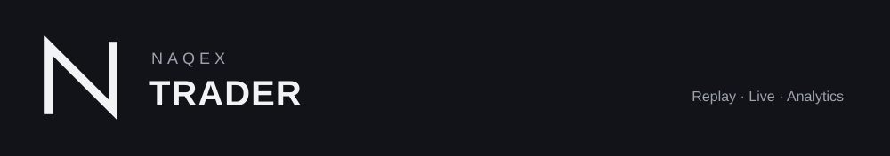
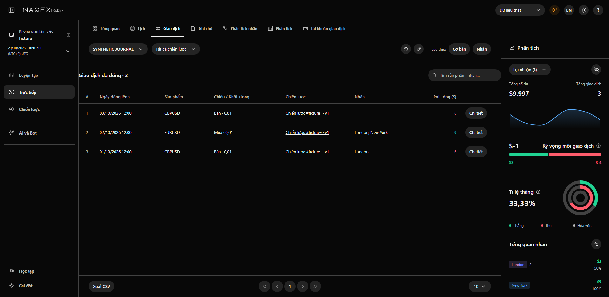
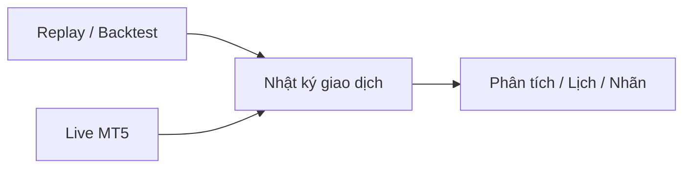

<p align="center"></p>

Backtest, luyện replay, nhật ký và phân tích giao dịch trong một workspace.
Live MT5 có kết nối và quyền thực thi được kiểm soát riêng.

[](https://github.com/Naqex/trader/actions/workflows/api-platform.yml)
[Version](VERSION) · [Bắt đầu phát triển](docs/development/README.md) · [License](docs/licensing.md)



*Ảnh từ fixture kiểm thử synthetic; không phải dữ liệu broker hoặc kết quả đầu tư.*

## Luồng sản phẩm



| Cần làm gì? | Điểm bắt đầu |
|---|---|
| Dựng frontend | Các lệnh bên dưới |
| Chạy backend Rust/PostgreSQL | [Runtime guide](foundation_v2/docs/RUST-NATIVE-RUNTIME.md) |
| Cài hoặc khôi phục Advanced Charts | [Vendor setup](docs/advanced-charts.md) |
| Sửa code, chạy test, tìm module | [Developer guide](docs/development/README.md) và [AGENTS.md](AGENTS.md) |
| Chuẩn bị version và xem giới hạn phát hành | [Release policy](docs/releases.md), [changelog](CHANGELOG.md) |

## Bắt đầu

Cần Git, Node.js 22+; Python 3.12 và `uv` cho adapters/kiểm tra. Backend cần Rust
và PostgreSQL theo [hướng dẫn đầy đủ](docs/development/README.md).

```powershell
git clone https://github.com/Naqex/trader.git
cd trader
npm ci --prefix foundation_v2/web --ignore-scripts
npm run build --prefix foundation_v2/web
npm run dev --prefix foundation_v2/web -- --host 127.0.0.1 --port 5173
```

`/api` mặc định chuyển tới `http://127.0.0.1:8010`; dùng `TW_V2_API_TARGET` cho
backend khác. Frontend chưa có API/dữ liệu sẽ hiện trạng thái thiếu hoặc lỗi.

## Source và quyền sử dụng

Source hiện hành nằm trong `foundation_v2/`: `web/` cho UI, `api-rust/` cho
backend, `trading_workspace_v2/` cho adapters; `ui/` giữ hợp đồng giao diện.
Các namespace và ID đã lưu giữ nguyên để tương thích.

Sản phẩm đang phát triển, trước 1.0. Hiện dùng source và build tại checkout;
đóng gói Windows để phân phối được để sang đợt sau. Replay là mô phỏng;
việc mở UI hoặc kết nối MT5 không tự cấp quyền gửi lệnh.

Copyright (c) 2026 Naqex. [Naqex Source Available License](LICENSE) cho phép
phạm vi cá nhân/nghiên cứu và giao dịch cá nhân đã quy định; khai thác thương mại
cần giấy phép riêng. Xem [chính sách license](docs/licensing.md),
[third-party notices](THIRD_PARTY_NOTICES.md) và [bảo mật](SECURITY.md).
