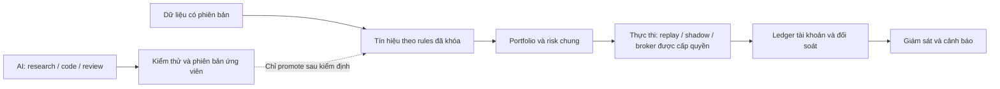

# Hệ thống trading tự động cho một người vận hành

Ngày đối chiếu: 15/11/2026, Asia/Saigon. Phạm vi: kiến trúc, nghiên cứu,
engine, môi trường AI và vận hành riêng cho owner; không gồm trade tay.
Đây là nghiên cứu và đề xuất, không phải nghiệm thu runtime hay chiến lược.

## Kết luận dành cho owner

Mục tiêu là hệ thống có lợi nhuận sau phí, đủ khả năng đi qua Challenge,
funded và nhận payout, với công sức vận hành phù hợp một người. Có hai
điều phải đạt riêng: tín hiệu có lợi thế và hệ thống thực thi đúng. Code,
CI, engine mạnh hoặc nhiều agent không thay thế được bằng chứng lợi nhuận.

Đề xuất: giữ kiến trúc hiện có, thu gọn đường vận hành chính; một owner
cho trạng thái tài khoản/risk/execution, nhiều công cụ nghiên cứu có vai trò
rõ. AI tăng tốc research, code và kiểm chứng; runtime giao dịch phải tiếp tục
hoạt động đúng khi cuộc chat hoặc nhà cung cấp LLM tạm ngừng.

## 1. Worktree đã được sửa và giới hạn cách ly

- Worktree này: `C:/Users/MIIKEY/.codex/worktrees/04e2/trader`.
- Nhánh riêng: `codex/solo-system-research`, xuất phát tại `e9ac368`.
- Thread gốc làm nghiên cứu trong `D:/ANNAM/TradingWorkspace`; lúc kiểm đã
  sang `codex/prop-cocore-v4`. Các số V3 là checkpoint trước, không đại diện
  cho kết quả V4 đang chạy.
- Lỗi cũ: đường `core.worktree` tương đối kế thừa từ Git submodule khiến
  Git nhận thư mục metadata là cây source. 5.836 mục thay đổi là báo sai
  đường dẫn, không phải bằng chứng source bị xoá. Nhận định trước về WIP
  hàng nghìn file được đính chính.
- Chỉ thêm absolute `core.worktree` vào `config.worktree` riêng của
  `worktrees/trader5`; giữ bản sao trước sửa. Git thường nhận đúng root,
  source sạch. 23 hash metadata chung/của worktree khác khớp qua lần sửa;
  một agent khác kiểm lại read-only. Không reset/restore/clean.
- Kiểm tra không có junction/symlink/reparse point trong cây source này.
  Tạo nhánh mới không đổi nhánh hay checkout của lane gốc.

[Biên bản sửa và bản sao cấu hình](C:/Users/MIIKEY/.codex/visualizations/2026/11/14/01a1daf7-cb89-7b83-ad62-cb0be1b35cdc/solo-system-review-20261115/isolation-repair.json).
Git worktree dùng chung objects/refs và một phần cấu hình; không phải máy ảo
hay ranh giới bảo mật. [Tài liệu Git](https://git-scm.com/docs/git-worktree).

**Ngoài Git còn một điểm thực tế:** environment đã có tên biến
`TW_V2_DATABASE_URL`; không đọc/ghi giá trị bí mật. API/UI mặc định cũng có
thể dùng cổng chung. Vì vậy lượt này chỉ đọc nguồn và viết báo cáo riêng.
Trước bất kỳ lần chạy runtime nào phải xác định DB riêng, data/artifact root,
cổng, PID/manifest và profile tài khoản; chỉ đổi branch không làm được việc đó.

| Tài nguyên | Cách dùng trong lane này |
|---|---|
| Source và index | Chỉ worktree 04e2 và nhánh riêng |
| Tài liệu/kết quả lane gốc | Đọc có phạm vi; không sửa CURRENT-CONTEXT, protocol hoặc số liệu gốc |
| Dữ liệu nguồn đã sealed | Có thể đọc nếu đúng scope được giao; không chỉnh cache gốc; lượt này không đọc giá |
| Output mới | Worktree này hoặc thư mục bằng chứng riêng của chat này |
| DB/API/MT5/Paperclip/gateway | Không khởi chạy, restart hay ghi state trong lượt research |
| Môi trường AI | Không sửa global config, skills gốc hay dispatch vào thread gốc |
| Hội nhập code | Sau này review diff trong đúng repo, tích hợp tuần tự; không tự nâng Trader gitlink |

Không có bảo đảm rằng mọi thay đổi tương lai đều merge không conflict.
Ranh giới trên ngăn ghi đè khi làm song song; conflict nội dung vẫn phải
được giải quyết khi hai lane cố ý hội nhập vào cùng nhánh.

## 2. Kinh nghiệm từ nguồn công khai và cách áp dụng

| Nguồn đã kiểm | Điều có bằng chứng | Cách áp dụng cho một người |
|---|---|---|
| [Two Sigma: Treating Data as Code](https://www.twosigma.com/articles/treating-data-as-code-at-two-sigma/) | Version dữ liệu/transform, kiểm chất lượng tự động, lineage và tái lập là phần cốt lõi của hệ thống dữ liệu | Giữ manifest, hash, timestamp và quality checks trong pipeline hiện có; không mặc định cần BigQuery/dbt/Terraform |
| [Man AHL: Overfitting](https://www.man.com/insights/overfitting-and-its-impact-on-the-investor) | Multiple testing và độ phức tạp gây overfit; mô hình đơn giản/có lý thuyết vẫn có thể sai. Có giá trị ở phân chia dữ liệu, stability, review và giữ kết quả thất bại | Budget thử nghiệm rõ, failed trials không biến mất, review kỹ thay đổi tiền/risk; không cần nhiều cấp phê duyệt cho sửa nhỏ |
| [AQR: Trading Costs of Asset Pricing Anomalies](https://www.aqr.com/insights/research/working-paper/trading-costs-of-asset-pricing-anomalies) | Phí thực thi và trade-off thay đổi theo style; nghiên cứu dùng dữ liệu giao dịch cổ phiếu tổ chức 1998–2011 | Đo chi phí theo tài sản/broker/chiến lược; kết quả AQR không xác nhận edge EURUSD/XAUUSD hoặc một con số slippage cho FTMO |
| [QuantConnect: Deployment](https://www.quantconnect.com/docs/v2/cloud-platform/live-trading/deployment) | Restart không tự phục hồi indicators/counters/custom state; khả năng lấy lại orders phụ thuộc brokerage. Hướng dẫn kiểm restart ở paper trading | Kiểm khôi phục từ ledger/checkpoint, đối chiếu positions/orders trước tiếp tục; một lần chạy thành công chưa kiểm được recovery |
| [Anthropic: Building effective agents](https://www.anthropic.com/research/building-effective-agents) | Bắt đầu bằng giải pháp đơn giản; workflow cố định và agent tự điều hướng có trade-off khác nhau về độ dự đoán, latency, chi phí | Dùng script/tool cho phép tính xác định; agent cho điều tra mở; chỉ thêm orchestration khi có lợi ích đo được |

Đây là nguyên tắc có thể chuyển giao, không phải bằng chứng rằng sao chép
stack của quỹ sẽ sinh lợi. Danh sách công nghệ không quyết định khả năng payout.

**Cộng đồng:** trong [thảo luận r/algotrading về triển khai thực tế](https://www.reddit.com/r/algotrading/comments/1sb4e9g/for_the_algotraders_who_have_live_deployment_of/),
có người kể lỗi reconnect, mất thông tin fills, sizing vượt dự định và
khác biệt paper/live; có người nhấn mạnh đối soát state với broker.
Đó là tự thuật không kiểm toán, không thể suy tỷ lệ thành công hoặc thời gian
đạt lợi nhuận. Giá trị cho ta là danh sách tình huống cần kiểm; không tiếp
nhận lời khuyên vào tiền thật ngay hay tăng risk từ cùng thread.

**Luật đích:** FTMO cho phép algorithmic trading/EAs theo điều kiện của họ;
FAQ cảnh báo EA bên thứ ba trùng chiến lược và hyperactivity. Engine tái sử
dụng khác với copy một EA kinh doanh chung.
[FAQ chiến lược](https://ftmo.com/en/faq/which-instruments-can-i-trade-and-what-strategies-am-i-allowed-to-use/).
FAQ hiện tại phân biệt Standard funded phải flat trước market break >2h,
trong khi Challenge/Verification và Swing có ngoại lệ. Do đó profile phải
gắn product/account type/phase và ngày hiệu lực; không dùng một cấu hình
chung gọi là “luật FTMO”. [FAQ giữ lệnh](https://ftmo.com/en/faq/can-i-hold-positions-overnight-or-over-the-weekend/).
Các trang hiện hành không xác nhận lịch sử spread/swap hay fill của tài khoản.

## 3. Video owner gửi

[How To Actually Build an AI Trading Bot With Claude — AI Pathways](https://www.youtube.com/watch?v=gJLKVsIqiTE).
YouTube xác nhận tiêu đề nhưng không trả transcript đầy đủ qua công cụ.
[Trang metadata thứ cấp](https://zolotube.com/watch?v=gJLKVsIqiTE) liệt kê:

| Mốc | Chương phù hợp để xem |
|---|---|
| 23:17 | System Layout |
| 1:10:53 | Proof & Backtesting |
| 1:49:21 | AI Layer |
| 1:56:46 | Harness & Connecting Bot |
| 2:07:46 | Risk & Safety |
| 2:25:14 | Adapting Bot |
| 2:34:30 | Claude Reviews |

Chưa xem/nghe trọn video; không dùng snippet/mirror để xác nhận các con số
lọc ứng viên, performance hoặc lời hứa lợi nhuận. Cách dùng hợp lý là đối
chiếu bố cục system → proof → execution → risk với hệ thống hiện tại.
Không copy chiến lược, phí hay tiêu chuẩn pass của video thành profile FTMO.

## 4. Kiến trúc phù hợp: nhỏ nhưng xử lý đủ vòng đời

Các ô là trách nhiệm, không phải yêu cầu tạo sáu microservices. Giữ backend
Rust/PostgreSQL và adapters/workers Python hiện có; không rewrite thành stack
mới chỉ vì một tutorial. Runtime risk/account ledger có một owner. Screening
có thể dùng engine khác, nhưng phải khai báo khác biệt timing, order/fill,
units, phí; không coi hai engine cùng ra số gần nhau là đã đúng broker.

| Phần | Đủ cho owner cá nhân | Không ưu tiên thêm lúc này |
|---|---|---|
| Dữ liệu | Nguồn gốc, giờ/units, gaps, Bid/Ask, immutable input, output riêng | Data lake phân tán hoặc tải thêm thị trường chưa có câu hỏi |
| Nghiên cứu | Một study card: giả thuyết, scope, budget, gate; script tái lập và trial history | Quét vô hạn hoặc vòng agent tự sửa rules đến khi có lãi |
| Engines | Engine chính cho trường hợp cần kiểm, engine đối chứng chọn lọc | Bắt mỗi nghiên cứu chạy toàn bộ engine có sẵn |
| Portfolio/risk | Tổng exposure, số lệnh, daily/static loss, funding, phase và reset rõ ràng | Mỗi bot tự tính một equity/risk độc lập trên cùng account |
| Vận hành | Start/stop có trạng thái; phục hồi; chống gửi trùng; báo lỗi đúng nguyên nhân | Nhiều dashboard quản trị hoặc service luôn bật chưa có nhu cầu |
| UI | Xem tình trạng, nghiên cứu, đối soát, quyết định promotion, dừng an toàn | Tính năng khách hàng, billing/multi-tenant, bộ luyện trade tay cho lane này |
| Triển khai | Một bản candidate, một bản đã chấp nhận; rollback và phân biệt account | Auto-deploy vào terminal đang giao dịch khi code vừa pass CI |

“Dùng full engine” nên có nghĩa dùng thực sự order/fill/accounting của engine
được chọn, thay vì chỉ tham khảo source. Điều đó không đòi mọi engine đều
trở thành nơi quản lý tài khoản thật. Thêm engine chỉ khi trả lời câu hỏi
mà công cụ hiện có chưa xử lý đúng hoặc giúp giảm thời gian đáng kể.

## 5. AI environment: gọn theo công việc, không theo số lượng tools

Tái dùng bốn vai trò: điều phối nghiên cứu, triển khai, đối soát độc lập,
chẩn đoán vận hành. Chúng không nhất thiết là bốn agent chạy liên tục.
Subagent phù hợp khi có phần độc lập và ownership rõ; mọi writer phải có
path/job riêng. Agent đối soát cần chứng minh khác biệt hoặc tái lập số học,
không chỉ đồng ý với lời giải thích của agent viết code.

- Skills nên route tới workflow/reference hiện có: strategy research,
  qualification, evidence continuity, Git và runtime operations. Không thêm
  skill chỉ vì có thêm một recipe hoặc một kết quả nghiên cứu.
- Tools nên làm việc hẹp, output có cấu trúc: kiểm input, chạy job có scope,
  đọc trạng thái, đối soát, xuất báo cáo. Signal không tự cấp quyền execution.
- Context của mỗi run gồm goal, input/code versions, data cutoff, budget,
  quyền và checkpoint. Lưu bằng chứng ở artifact/ledger có owner, không chỉ chat.
- Một run không được tự đổi provider/model có phí, sửa risk đang chạy hoặc
  mở holdout để tìm câu trả lời đẹp hơn. Việc test code và việc đủ edge tách rõ.
- Đo chi phí vận hành thực: thời gian owner phải can thiệp, lỗi lặp, khả năng
  resume, thời gian từ ý tưởng tới verdict có bằng chứng; không đếm số tool
  hoặc agent như một chỉ số thành công.

Đây là đề xuất kiến trúc của lane này. Chưa sửa/cài skill, MCP, global
config hoặc đổi quyền runtime. Quyền research hiện tại không mở broker.

## 6. Đối chiếu tài sản dự án đã có

Các tài liệu bên dưới là nguồn để reuse; nhiều phần là snapshot thiết kế
hoặc nghiệm thu theo phạm vi cũ, không chứng minh trạng thái live hôm nay.

| Nguồn local đã đọc | Có thể reuse | Cần kiểm tiếp khi được giao implementation |
|---|---|---|
| [AI platform architecture](../../foundation_v2/docs/AI-PLATFORM-ARCHITECTURE.md) | Admission Rust, persistence PostgreSQL, workers và boundaries | Capabilities và recovery tại revision thực; tránh phục hồi UI/quy trình đã retired |
| [Strategy workflow](D:/ANNAM/TradingWorkspace/tooling/ai-engines/STRATEGY-WORKFLOW.md) | Stage gates, feasibility, cadence, evidence routing | Chọn một luồng end-to-end cụ thể; kiểm gate đang được code thực thi |
| [Studio operations](D:/ANNAM/TradingWorkspace/tooling/ai-engines/OPERATIONS.md) | Paperclip native ownership, observer, shadow lifecycle, saved-data diagnostics | Cảnh báo độc lập khi PC/app mất kết nối vẫn là gap được ghi trong guide |
| [Engine study](D:/ANNAM/TradingWorkspace/planning/research/STRATEGY-DEPTH-ENGINES-AND-MILESTONES-20261112.md) | Vai trò và giới hạn của Nautilus/LEAN/VectorBT/Backtrader/Backtesting.py | Docs/version/native fixtures cần khớp đúng consumer, không nâng engine theo tên gọi |
| [V3 results](D:/ANNAM/TradingWorkspace/planning/research/PROP-PORTFOLIO-V3-RESULTS-20261114.md) | Ví dụ evidence về funding, paired ticks, shared account, concentration | Đây là checkpoint V3; lane gốc đang V4, không chạy lại/chọn lại candidate tại đây |

Tài liệu Studio đã ghi rõ observer trong cùng PC/app không phải hệ thống báo
động độc lập nếu cả máy ngừng. Với một người vận hành, cần đưa tình huống đó
vào kế hoạch acceptance sau này; chưa cài watcher/service trong lượt này.

## 7. Phân chia hai lane và thứ tự triển khai đề xuất

| Lane gốc đang chạy | Lane worktree này |
|---|---|
| Nghiên cứu alpha/portfolio V4 theo task owner giao | Rà kiến trúc, AI workflow và khả năng một người vận hành |
| Sở hữu protocol, candidate selection và kết quả của campaign đó | Dùng kết quả đã công bố làm input; không đổi campaign gốc |
| Job, cache và báo cáo đang sử dụng | Báo cáo/fixtures/job riêng khi có slice triển khai |

Trình tự đề xuất cho lane này:

1. **Cách ly đường ghi:** đã sửa Git root, kiểm source sạch, tạo branch riêng.
   Runtime chưa mở; DB/port/state phải được chỉ định riêng nếu cần chạy.
2. **Map luồng đang có:** một sơ đồ từ data → nghiên cứu → kiểm định → promotion
   → execution/ledger; với mỗi ranh giới chỉ rõ owner và bằng chứng đã có.
   Không cần audit mọi màn hình hoặc rewrite toàn app.
3. **Sửa nút thắt hữu ích nhất:** ưu tiên lỗi có reproduction như sai root,
   quote thiếu, gửi lệnh trùng sau mất phản hồi, recovery sai state hoặc report
   gọi thiếu dữ liệu là zero. Fixture/saved replay trước khi xin live run mới.
4. **Rehearsal vận hành:** khi có scope được giao, kiểm restart có vị thế,
   timeout chưa rõ kết quả, lịch/reset/DST, spread spike, stale quote và restore
   backup trên môi trường riêng. So khớp ledger, không chỉ process exit 0.
5. **Hội nhập tuần tự:** review đúng commit; chỉ lane tích hợp mới nâng pin và
   promote runtime. Bản nghiên cứu tốt chưa tự là bản vận hành được phép gửi lệnh.

Không ấn định số ngày paper trading chung hoặc tỷ lệ pass tương lai từ
cộng đồng. Thời gian kiểm cần bám tình huống cần quan sát, số cơ hội độc lập
và mức bất định còn lại. Mục tiêu cho owner là ít can thiệp, hiểu rõ hệ thống
đang làm gì, khôi phục được khi hỏng, và thấy tiến bộ về kinh tế sau phí.

## Phạm vi hoàn thành của lượt này

Đã sửa cấu hình Git riêng, có backup/receipt và read-only verification khác;
research nguồn official/quỹ/cộng đồng/video metadata; ghi đề xuất theo use case
solo. Chỉ thay tài liệu ở nhánh riêng. Không đọc giá 2025–2026, không chạy
backtest, kết nối DB/broker, restart dịch vụ hoặc cập nhật global AI config.
Chưa tuyên bố audit toàn bộ code, khả năng broker, hay performance chiến lược đạt.
