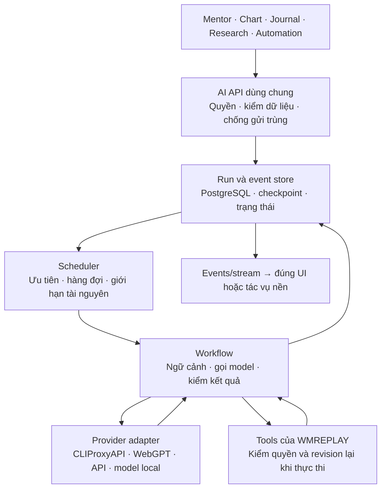

# Nền tảng AI dùng xuyên suốt WMREPLAY

Định hướng thiết kế ngày 23/10/2026, theo yêu cầu owner: AI là năng lực dùng thường
xuyên ở nhiều tính năng, không chỉ một hộp chat. Đây là thiết kế đích và tiêu chí
chuyển đổi, chưa phải bằng chứng triển khai/benchmark hoặc cấp quyền broker.
[Product Completion Plan](../../../../planning/mt5-tradingview-backtester/PRODUCT-COMPLETION-PLAN.md)
vẫn own phạm vi và acceptance toàn sản phẩm; tài liệu này không tạo ledger mới.
Luồng provider đã triển khai và receipts nằm ở [AI-PROVIDERS.md](AI-PROVIDERS.md).

## Hiện trạng đối chiếu source

| Phần | Đang có | Giới hạn cần xử lý |
| --- | --- | --- |
| Chat/Mentor | `api-rust/src/ai_assistant.rs`, React chat dùng chung | Một `ChatTurn` trong RAM, lựa chọn provider/model chung; chưa phù hợp nhiều feature chạy đồng thời |
| Transport | CLIProxyAPI local và WebGPT core | Text-only, phản hồi hoàn tất rồi UI mới nhận; chưa nghiệm thu Google OAuth/inference/pool thật |
| Ngữ cảnh | Policy do server sở hữu; route/locale là dữ liệu | Chat chưa đọc chart/tài khoản; không được quảng bá đã hiểu dữ liệu đang mở |
| AI nghiệp vụ | `api-rust/src/control_routes.rs` và `trading_workspace_v2/chart_ai_contract.py` | Contract advisory/offline riêng, chưa nối cùng runtime chat; cần kiểm tương đương schema/cutoff khi hội tụ |
| Tác vụ dài | `api-rust/src/research_jobs/lifecycle.rs` | Đã có lease/attempt/fencing/cancel; reuse cơ chế có bằng chứng, không coi research job là AI run hoặc dùng bảng cũ tùy tiện |
| Evals | `scripts/ai_chat_evals.py` và HTTP/UI fixtures | Live evaluator còn gọi alias ChatGPT; chưa là bộ đánh giá đa tính năng/đa provider |

## Quyết định nền

Giữ Rust/Axum là cửa vào và nơi kiểm quyền; PostgreSQL giữ trạng thái bền vững.
Tách module theo trách nhiệm trong backend hiện có trước khi tách service. Gateway
vẫn là process riêng. Chưa có bằng chứng cần thêm Redis, Kafka, Kubernetes hoặc một
backend Node/Python trên đường tương tác chỉ để dùng framework AI.

API/model local trong sơ đồ là extension đích, chưa phải provider đã tích hợp.
Không bắt mọi tác vụ đi qua vòng agent: phép tính xác định chạy bằng domain code;
phân loại/trích xuất dùng một model call có schema; chỉ dùng workflow nhiều bước
khi tính năng thực sự cần.

## Contract và ownership cần có

- **Run:** định danh workspace/subject, feature, conversation hoặc object đích,
  request/idempotency key, context revision, phiên bản workflow/prompt và snapshot
  lựa chọn provider/model. Cấu hình model theo tính năng; đổi mặc định không đổi
  model giữa run đang chạy. Một object có thể giới hạn tuần tự mà các object khác
  vẫn chạy song song trong global/provider cap.
- **Lưu bền:** run, attempt, messages và events/checkpoints có owner rõ trong DB.
  Sau restart đọc lại trạng thái; không tự coi request chưa rõ kết quả là thất bại
  rồi gửi lại. Tác vụ dài dùng lease/fencing và renew. Không giữ transaction hay
  connection DB trong lúc chờ model. Lưu lịch sử không đồng nghĩa đã có durable
  execution cho từng bước workflow.
- **Context:** backend dựng snapshot tối thiểu theo quyền, source/revision/hash,
  run/cursor/timeframe/cutoff và thời điểm dữ liệu. Reuse contract chart hiện có,
  không đưa future bars/holdout/secret vào prompt. Kết quả cũ không tự áp vào chart
  hoặc account đã đổi revision. Memory bền tách khỏi dữ liệu nguồn và có cơ chế
  sửa/xóa; chưa cần vector DB nếu truy vấn/PostgreSQL đáp ứng được.
- **Capabilities:** kiểm thật text/vision/streaming/structured-output/tools theo
  model và endpoint; không suy từ nhãn tương thích OpenAI. Workflow yêu cầu tools
  phải từ chối provider chưa đạt. Không đổi model/provider/kênh có phí âm thầm.
- **Tools:** allowlist theo workflow, input/output có schema, quyền tối thiểu,
  kiểm workspace/revision/generation lại lúc chạy. Phân biệt read, ghi có undo và
  external effect. Lệnh broker đi qua execution domain hiện có; LLM không sở hữu
  credential, arithmetic/risk gate hoặc quyền gọi terminal tùy ý. Chỉ thị trong
  tài liệu/tin tức/tool output không được trở thành quyền thực thi.
- **Output:** text chat và kết quả nghiệp vụ có contract khác nhau. Overlay/rule
  draft cần schema, provenance, kiểm domain và preview/apply có undo; không lấy
  văn bản model làm lệnh thực thi. Tool call đang chờ quyền giữ trạng thái riêng.
- **Phục hồi:** phân biệt cancel requested/cancelled, failed/interrupted và kết
  quả external chưa rõ. Reconnect UI chỉ đọc lại events, không tạo inference mới.
  Retry chỉ ở một tầng được chỉ định, có giới hạn và nhận diện từng attempt;
  không hứa exactly-once đối với model/tool/broker bên ngoài.

## Hiệu suất khi AI được dùng liên tục

Scheduler cần tách ưu tiên tương tác và nền; giữ capacity cho Mentor/chart, gộp
các yêu cầu nền đã bị thay thế, chống starvation. Mỗi provider có concurrency,
deadline và request/token budget riêng, cộng global cap. Số credential trong pool
không được dùng làm bằng chứng có thể tăng concurrency tương ứng.

Gọi AI theo sự kiện/ngữ cảnh có thay đổi: đóng nến, yêu cầu phân tích, cập nhật
journal hoặc lịch định trước. Tránh gọi model theo mỗi tick/render. Reuse chỉ báo,
metrics và truy vấn domain để giảm payload. Debounce/cancel hoặc supersede task
cũ; cache chỉ khi hợp ngữ nghĩa, key gồm scope, dữ liệu/cutoff, prompt/workflow,
provider/model và tham số ảnh hưởng kết quả. Không cache/replay tool có side effect.

Token stream và sự kiện tiến độ đi qua contract chung (SSE là ứng viên reuse
Axum hiện tại); client chậm không làm buffer tăng vô hạn. Có event ID/replay window,
backpressure và snapshot fallback; reconnect không tự gọi lại model. Công việc
CPU/GPU local không chặn async executor hoặc gây giật chart.

Theo dõi queue wait, first-token/total latency, attempt, lỗi/cancel, input/output
tokens, CPU/RAM/GPU và ảnh hưởng p95 của UI/API/broker heartbeat. Usage/cost không
được upstream cung cấp phải là unknown, không phải0. Trace mặc định chỉ metadata
đã lọc; raw prompt/tool data là opt-in có retention và phạm vi quyền rõ.

## Reuse SDK hay tự xây

| Thành phần | Hướng chọn |
| --- | --- |
| Trading tools, context cutoff, quyền và nghiệp vụ | WMREPLAY own; reuse domain service/contract, không giao cho SDK/provider |
| OAuth, credential pool, protocol translation | CLIProxyAPI upstream ghim phiên bản; giữ adapter nhỏ, chưa fork |
| Browser transport ChatGPT | WebGPT core dùng chung hiện có; không nhân bản harness theo từng feature |
| Streaming, typed tools/output, agent loop | Ưu tiên đánh giá SDK trước khi tự viết; SDK phải nằm sau boundary của sản phẩm |
| Jobs, persistence, events | Reuse hạ tầng Rust/PostgreSQL hiện có sau khi chứng minh phù hợp với AI; không giả một chat slot là durable runtime |

Ứng viên đánh giá đầu tiên là **Rig** vì Rust-native/MIT và có provider/tool/agent
primitives. Đây là shortlist, không phải quyết định cài hoặc chứng minh tương thích
CLIProxyAPI/WebGPT. So với adapter hiện tại bằng đúng fixture: Responses, streamed
events, structured output, tool loop, cancel, lỗi/partial response, custom loopback
endpoint, token accounting, dependency/build footprint và Windows compatibility.

**PydanticAI/LangGraph** là đối chiếu cho typed agents/durable workflows; chỉ đưa
vào worker riêng khi nhu cầu và kiểm chứng bù được một runtime khác. **Vercel AI
SDK** có UI/provider primitives tốt để khảo sát, nhưng không đổi backend Rust sang
Node chỉ vì UI đang dùng React. Không cài tất cả SDK hoặc bọc nhiều tầng agent.

## Thứ tự chuyển đổi và bằng chứng cần đạt

1. Chốt contract và inventory tính năng; thêm run/config/message/event persistence
   và admission có giới hạn. Giữ alias chat cũ; test nhiều feature/scope đồng thời,
   không ghi đè kết quả nhau, config snapshot và restart/cancel. Migration thật có
   rollout/backup gate; chưa áp migration trong lượt thiết kế này.
2. Spike SDK cách ly và provider-neutral eval. Bắt đầu synthetic/offline; đánh giá
   một model thật sau owner OAuth, rồi pool/cancel/quota. Chỉ promote khi đạt cùng
   fixture; chưa tuyên bố SDK, pool hay chất lượng model đã đạt.
3. Tích hợp dọc Mentor + một tính năng đọc dữ liệu (chart hoặc journal) qua cùng
   runtime: context đúng revision/cutoff, stream, lỗi/unknown, reconnect và vi/en.
   Hợp nhất boundary AI offline cũ theo contract parity, không xóa trước khi thay.
4. Thêm background workflows/tools từng nhóm. Kiểm quyền/revoke, replay chống gửi
   trùng, prompt injection, stale output và crash giữa các bước. Automation/broker
   cần acceptance riêng; không mở theo việc một tool demo trả kết quả.

Load fixture phải trộn chat, phân tích chart, journal nền và outage/cancel, chạy
cùng workload/budget/máy với baseline. Chốt ngưỡng queue/latency/resource trước đo;
đo ảnh hưởng lên chart và heartbeat MT5, không dùng throughput AI riêng để claim
toàn sản phẩm nhanh. Mỗi lát giữ rollback provider/config/schema tương thích.

## Nguồn primary đã đối chiếu

- [Rig upstream và license](https://github.com/0xPlaygrounds/rig),
  [manifest](https://github.com/0xPlaygrounds/rig/blob/main/crates/rig-core/Cargo.toml).
- [PydanticAI durable execution](https://pydantic.dev/docs/ai/capabilities/durable_execution/overview/):
  phân biệt persistence với durable workflow execution.
- [LangGraph overview](https://docs.langchain.com/oss/python/langgraph/overview):
  orchestration/persistence/streaming; chưa đánh giá runtime trong repo.
- [Vercel AI SDK](https://ai-sdk.dev/docs/introduction): TypeScript/provider/UI
  primitives, không là lý do tự đổi stack.
- [OWASP excessive agency](https://genai.owasp.org/llmrisk/llm062025-excessive-agency/):
  ranh giới functionality, permission và autonomy.

Lượt này chỉ đối chiếu source/tài liệu và ghi thiết kế. Chưa cài SDK/dependency,
chạy benchmark/provider, sửa DB hoặc thay runtime đang hoạt động.
