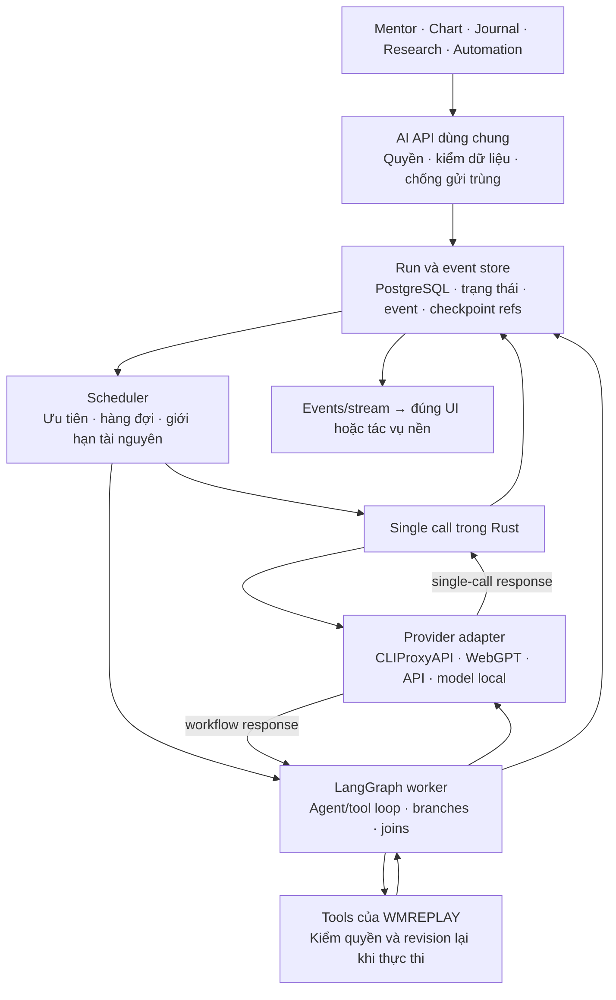

# Nền tảng AI dùng xuyên suốt WMREPLAY

Định hướng thiết kế ngày 23/10/2026, theo yêu cầu owner: AI là năng lực dùng thường
xuyên ở nhiều tính năng, không chỉ một hộp chat. Đây là thiết kế đích và tiêu chí
chuyển đổi, chưa phải bằng chứng triển khai/benchmark hoặc cấp quyền broker.
[Product Completion Plan](../../../../planning/mt5-tradingview-backtester/PRODUCT-COMPLETION-PLAN.md)
vẫn own phạm vi và acceptance toàn sản phẩm; tài liệu này không tạo ledger mới.
Review liên project và bằng chứng offline: [AI workspace architecture](../../../../planning/research/AI-WORKSPACE-ARCHITECTURE-2026-10-23.md).
Quyết định sau review: Rust own API/admission/public events; Python/LangGraph own
workflow nhiều bước. Không có agent engine thứ hai trong Rust ở lát đầu.
Luồng provider đã triển khai và receipts nằm ở [AI-PROVIDERS.md](AI-PROVIDERS.md).

## Hiện trạng đối chiếu source

| Phần | Đang có | Giới hạn cần xử lý |
| --- | --- | --- |
| Chat/Mentor | `ai_runs.rs`, `ai_profiles.rs`, `ai_agents.rs`, React chat dùng chung; migrations0012–0014 đã rollout local | Runs/events/history và agents lưu PostgreSQL; đã thử Gemini thật, Stop/reload/Continue và agent knowledge; chưa nghiệm thu tải đồng thời thật |
| Transport | CLIProxyAPI local và WebGPT core, `ai_response.rs`; catalog có tên hiển thị/effort được upstream công bố | Text-only; Gemini thật đã trả lời; pool3 credentials đã audit cấu hình, chưa nghiệm thu rotation/failover/quota hoặc capability từng model |
| Ngữ cảnh | Policy do server sở hữu; route/locale là dữ liệu | Chat chưa đọc chart/tài khoản; không được quảng bá đã hiểu dữ liệu đang mở |
| AI nghiệp vụ | `api-rust/src/control_routes.rs` và `trading_workspace_v2/chart_ai_contract.py` | Contract advisory/offline riêng, chưa nối cùng runtime chat; cần kiểm tương đương schema/cutoff khi hội tụ |
| Tác vụ dài | `api-rust/src/research_jobs/lifecycle.rs` | Đã có lease/attempt/fencing/cancel; reuse cơ chế có bằng chứng, không coi research job là AI run hoặc dùng bảng cũ tùy tiện |
| Workflow | `ai_workflows.rs` → `trading_workspace_v2/ai_workflow.py`; worker interpreter đã cấu hình trong runtime local | Hai nhánh và join qua admission Rust đã qua PostgreSQL/Python fixtures; chưa chạy pilot nhiều model thật, nối Quant tools/TradingAgents domain graph hoặc có UI gọi workflow |
| Evals | `scripts/ai_chat_evals.py` và HTTP/UI fixtures | Live evaluator còn gọi alias ChatGPT; chưa là bộ đánh giá đa tính năng/đa provider |

Đối chiếu ngày 23/10/2026 với source, [deployment](../evidence/ai-platform-deployment-20261023/RECEIPT.md),
[agents](../evidence/ai-agents-20261023/RECEIPT.md),
[Stop/Continue](../evidence/ai-chat-continuation-20261023/RECEIPT.md) và GET local hiện tại:
gateway ready, 3 models; WebGPT stopped; system profile revision 2 dùng Gemini qua gateway.
Đây là snapshot readiness/cấu hình, không là load test. Agent user tạo là preset
hướng dẫn/knowledge của chat, không phải subagent thực thi song song.

Ba lát đã có nền source và local rollout; acceptance chưa đồng đều. Lát 1 có
connections/catalog và profiles theo feature/role, nhưng direct API/local model vẫn
chưa nối. Lát 2 đã dùng được với một chat thật; nhiều chat/model, nền so với tương
tác và pool cần kiểm chứng cùng workload thật. Lát 3 mới là fixed text-review pilot;
cập nhật TradingAgents trong repo riêng không có nghĩa graph của nó đã tích hợp.
Scheduler hiện chọn FIFO theo thời điểm enqueue trong cap; chưa có capacity dành
riêng cho tương tác, token budget hoặc bằng chứng p95 chart/MT5 khi AI chịu tải.

Bước tiếp theo là nghiệm thu có giới hạn: hai chat model khác nhau cùng pilot
facts/gaps→reviewer, kiểm snapshot/reload/cancel và đo queue wait/first-token/total,
RAM/CPU cùng độ phản hồi chart/API. Chỉ nâng cap hay thêm scheduling khi thấy
bottleneck. Sau đó nối một context chart hoặc journal chỉ đọc, có revision/cutoff;
chưa mở rộng automation, broker hay Auto routing.

## Quyết định nền

Giữ Rust/Axum là cửa vào và nơi kiểm quyền; PostgreSQL giữ trạng thái bền vững.
Tách module theo trách nhiệm trong backend hiện có trước khi tách service. Gateway
vẫn là process riêng. Chưa có bằng chứng cần thêm Redis, Kafka, Kubernetes hoặc một
backend Node trên đường tương tác chỉ để dùng framework AI. Worker Python hữu hạn
phục vụ complex workflows; single-call tasks gọi adapter từ Rust với cùng admission.
Một run giữ model/config snapshot và một graph instance riêng; LangGraph own
private node checkpoints, Rust own lifecycle/events công khai. Không dùng automatic
research-job requeue cho call/external effect chưa rõ kết quả.

API/model local trong sơ đồ là extension đích, chưa phải provider đã tích hợp.
Không bắt mọi tác vụ đi qua vòng agent: phép tính xác định chạy bằng domain code;
phân loại/trích xuất dùng một model call có schema; chỉ dùng workflow nhiều bước
khi tính năng thực sự cần.

## Contract và ownership cần có

- **Run:** định danh workspace/subject, feature, conversation hoặc object đích,
  request/idempotency key, context revision, phiên bản workflow/prompt và snapshot
  lựa chọn provider/model. Cấu hình model theo tính năng; đổi mặc định không đổi
  model giữa run đang chạy. Một object có thể giới hạn tuần tự mà các object khác
  vẫn chạy song song trong global/provider cap.
- **Lưu bền:** run, attempt, messages và events/checkpoints có owner rõ trong DB.
  Sau restart đọc lại trạng thái; không tự coi request chưa rõ kết quả là thất bại
  rồi gửi lại. Tác vụ dài dùng lease/fencing và renew. Không giữ transaction hay
  connection DB trong lúc chờ model. Lưu lịch sử không đồng nghĩa đã có durable
  execution cho từng bước workflow.
- **Context:** backend dựng snapshot tối thiểu theo quyền, source/revision/hash,
  run/cursor/timeframe/cutoff và thời điểm dữ liệu. Reuse contract chart hiện có,
  không đưa future bars/holdout/secret vào prompt. Kết quả cũ không tự áp vào chart
  hoặc account đã đổi revision. Memory bền tách khỏi dữ liệu nguồn và có cơ chế
  sửa/xóa; chưa cần vector DB nếu truy vấn/PostgreSQL đáp ứng được.
- **Capabilities:** kiểm thật text/vision/streaming/structured-output/tools theo
  model và endpoint; không suy từ nhãn tương thích OpenAI. Workflow yêu cầu tools
  phải từ chối provider chưa đạt. Không đổi model/provider/kênh có phí âm thầm.
- **Tools:** allowlist theo workflow, input/output có schema, quyền tối thiểu,
  kiểm workspace/revision/generation lại lúc chạy. Phân biệt read, ghi có undo và
  external effect. Lệnh broker đi qua execution domain hiện có; LLM không sở hữu
  credential, arithmetic/risk gate hoặc quyền gọi terminal tùy ý. Chỉ thị trong
  tài liệu/tin tức/tool output không được trở thành quyền thực thi.
- **Output:** text chat và kết quả nghiệp vụ có contract khác nhau. Overlay/rule
  draft cần schema, provenance, kiểm domain và preview/apply có undo; không lấy
  văn bản model làm lệnh thực thi. Tool call đang chờ quyền giữ trạng thái riêng.
- **Phục hồi:** phân biệt cancel requested/cancelled, failed/interrupted và kết
  quả external chưa rõ. Reconnect UI chỉ đọc lại events, không tạo inference mới.
  Retry chỉ ở một tầng được chỉ định, có giới hạn và nhận diện từng attempt;
  không hứa exactly-once đối với model/tool/broker bên ngoài.

## Hiệu suất khi AI được dùng liên tục

Scheduler cần tách ưu tiên tương tác và nền; giữ capacity cho Mentor/chart, gộp
các yêu cầu nền đã bị thay thế, chống starvation. Mỗi provider có concurrency,
deadline và request/token budget riêng, cộng global cap. Số credential trong pool
không được dùng làm bằng chứng có thể tăng concurrency tương ứng.

Gọi AI theo sự kiện/ngữ cảnh có thay đổi: đóng nến, yêu cầu phân tích, cập nhật
journal hoặc lịch định trước. Tránh gọi model theo mỗi tick/render. Reuse chỉ báo,
metrics và truy vấn domain để giảm payload. Debounce/cancel hoặc supersede task
cũ; cache chỉ khi hợp ngữ nghĩa, key gồm scope, dữ liệu/cutoff, prompt/workflow,
provider/model và tham số ảnh hưởng kết quả. Không cache/replay tool có side effect.

Token stream và sự kiện tiến độ đi qua contract chung (SSE là ứng viên reuse
Axum hiện tại); client chậm không làm buffer tăng vô hạn. Có event ID/replay window,
backpressure và snapshot fallback; reconnect không tự gọi lại model. Công việc
CPU/GPU local không chặn async executor hoặc gây giật chart.

Theo dõi queue wait, first-token/total latency, attempt, lỗi/cancel, input/output
tokens, CPU/RAM/GPU và ảnh hưởng p95 của UI/API/broker heartbeat. Usage/cost không
được upstream cung cấp phải là unknown, không phải0. Trace mặc định chỉ metadata
đã lọc; raw prompt/tool data là opt-in có retention và phạm vi quyền rõ.

## Reuse SDK hay tự xây

| Thành phần | Hướng chọn |
| --- | --- |
| Trading tools, context cutoff, quyền và nghiệp vụ | WMREPLAY own; reuse domain service/contract, không giao cho SDK/provider |
| OAuth, credential pool, protocol translation | CLIProxyAPI upstream ghim phiên bản; giữ adapter nhỏ, chưa fork |
| Browser transport ChatGPT | WebGPT core dùng chung hiện có; không nhân bản harness theo từng feature |
| Streaming, typed tools/output, agent loop | Ưu tiên đánh giá SDK trước khi tự viết; SDK phải nằm sau boundary của sản phẩm |
| Jobs, persistence, events | Reuse hạ tầng Rust/PostgreSQL hiện có sau khi chứng minh phù hợp với AI; không giả một chat slot là durable runtime |

Ưu tiên **LangGraph** cho workflow nhiều bước sau đối chiếu TradingAgents
upstream 0.7.0: isolated parallel analysts, join barrier, run-scoped config và
provider riêng theo quick/deep tier. Reuse execution primitives và thiết kế; không
lấy toàn bộ debate graph làm harness cho mọi tính năng. SDK adapters chỉ gọi
registered route sau per-call admission, không tự bypass quota/retry policy.

**Rig/PydanticAI** giữ vai trò challenger nếu benchmark cùng fixture cho thấy
đơn giản hơn hoặc nhanh/nhẹ hơn đáng kể. Không thêm nhiều runtime trước khi có
bằng chứng. Implementation cũ không được ưu tiên chỉ vì đang có: thay RAM chat slot/global
selection bằng persistent per-conversation runs; giữ domain contracts/cutoff và
đánh giá lại implementation. Rust không là bằng chứng toàn app nhanh nhất.

Per-call permits khác run leases: parent chờ subagent không giữ model slot. Mọi
child call phải được admission, có deadline, cancellation phase và usage tracking.
Model discovery/capability/status phân biệt asserted với verified; model ID và
`high` không có cùng semantics giữa provider. Không âm thầm đổi route/effort.

## Thứ tự chuyển đổi và bằng chứng cần đạt

1. Chốt contract và inventory tính năng; thêm run/config/message/event persistence
   và admission có giới hạn. Giữ alias chat cũ; test nhiều feature/scope đồng thời,
   không ghi đè kết quả nhau, config snapshot và restart/cancel. Migration thật có
   rollout/backup gate; chưa áp migration trong lượt thiết kế này.
2. Spike worker/adapter cách ly và provider-neutral eval. Bắt đầu synthetic/offline; đánh giá
   một model thật sau owner OAuth, rồi pool/cancel/quota. Chỉ promote khi đạt cùng
   fixture; chưa tuyên bố SDK, pool hay chất lượng model đã đạt.
3. Tích hợp dọc Mentor + một tính năng đọc dữ liệu (chart hoặc journal) qua cùng
   runtime: context đúng revision/cutoff, stream, lỗi/unknown, reconnect và vi/en.
   Hợp nhất boundary AI offline cũ theo contract parity, không xóa trước khi thay.
4. Thêm background workflows/tools từng nhóm. Kiểm quyền/revoke, replay chống gửi
   trùng, prompt injection, stale output và crash giữa các bước. Automation/broker
   cần acceptance riêng; không mở theo việc một tool demo trả kết quả.

Load fixture phải trộn chat, phân tích chart, journal nền và outage/cancel, chạy
cùng workload/budget/máy với baseline. Chốt ngưỡng queue/latency/resource trước đo;
đo ảnh hưởng lên chart và heartbeat MT5, không dùng throughput AI riêng để claim
toàn sản phẩm nhanh. Mỗi lát giữ rollback provider/config/schema tương thích.

## Nguồn primary đã đối chiếu

- [Rig upstream và license](https://github.com/0xPlaygrounds/rig),
  [manifest](https://github.com/0xPlaygrounds/rig/blob/main/crates/rig-core/Cargo.toml).
- [PydanticAI durable execution](https://pydantic.dev/docs/ai/capabilities/durable_execution/overview/):
  phân biệt persistence với durable workflow execution.
- [LangGraph overview](https://docs.langchain.com/oss/python/langgraph/overview):
  orchestration/persistence/streaming; có offline fixtures/TradingAgents regression, chưa product worker acceptance.
- [Vercel AI SDK](https://ai-sdk.dev/docs/introduction): TypeScript/provider/UI
  primitives, không là lý do tự đổi stack.
- [OWASP excessive agency](https://genai.owasp.org/llmrisk/llm062025-excessive-agency/):
  ranh giới functionality, permission và autonomy.

Review có offline LangGraph probes và topology fixture; TradingAgents được nâng
upstream và kiểm regression trong repo độc lập. Worker pilot hiện nối được API
WMREPLAY trong fixture độc lập; chưa benchmark model thật, sửa DB hoặc thay runtime
sản phẩm đang hoạt động.

## Lát persistence và chat đã triển khai trong source

Migration `0012_ai_runs.sql` bổ sung profiles, conversations, runs, events và call
permits. `/api/v2/ai/assistant/chat` giữ alias202; client mới gửi UUID conversation,
idempotency key và lựa chọn model. Cùng key/input trả lại cùng run kể cả khi default
đổi; key với input khác trả409. SSE `/chat/{id}/events?after=N` hoặc Last-Event-ID
chỉ đọc lại event, không gửi inference. Trạng thái/cấu hình tách theo workspace và
subject; profile ưu tiên role → feature default → system default. Legacy connection
default chỉ bootstrap chat khi chưa có profile.

Lease30s, heartbeat5s, deadline210s. Dispatcher tối đa4 tasks; model permits global4,
gateway3/WebGPT1/workspace3. Queue64 toàn cục/16 workspace. Không giữ DB connection
khi chờ provider, không tự retry/requeue outcome chưa rõ. Lease hết hạn thành
`interrupted`; call đã đánh dấu sent thành `unknown`. Cancel sau khi sent không hứa
dừng xử lý ở upstream. Completion đến trước cancel vẫn giữ kết quả.

Progress dùng một watch snapshot, text256KiB, wire stream1MiB. Delta nối vào
snapshot; checkpoint tối đa mỗi250ms, event lưu delta/byte offset, row lưu partial.
Khi cancel/fail, snapshot mới nhất được giữ kể cả chưa đến checkpoint. Reasoning
chỉ công bố phase thinking, không lưu/hiện nội dung suy luận riêng của model.
Tối đa16 SSE sessions/process,
mỗi session240s; UI reconnect cùng run với snapshot repair. History keyset pagination,
tối đa500 conversations/principal/workspace và64 runs/conversation. Chạm cap trả lỗi,
không tự xóa lịch sử. Mỗi trang message tối đa512KiB; xóa conversation cascade khi
không còn run hoạt động. LocalStorage giữ ID để mở lại chat và lựa chọn
provider/model/effort mới nhất theo workspace, kể cả khi chưa gửi. Reload ưu tiên
lựa chọn local; khi chủ động mở chat từ history, dùng selection của chat đó.
Chat mới/đổi agent giữ lựa chọn hiện tại. Catalog ready xác nhận model bị gỡ thì
ưu tiên default hợp lệ trong cùng provider, rồi model đầu tiên của provider đó;
provider bị gỡ hoàn toàn mới xét route sẵn sàng khác. Route offline/catalog lỗi
không xóa lựa chọn hoặc tự chuyển provider. Effort bị gỡ về default gateway hoặc
mức đầu tiên được WebGPT công bố. Những thay đổi này chỉ áp dụng lượt gửi mới,
không thay snapshot của run đã được nhận; storage bị chặn chỉ mất khả năng nhớ
qua reload, không làm hỏng phiên hiện tại.

Dừng giữ câu hỏi và phần trả lời đã nhận, kể cả sau reload. Tiếp tục tham chiếu
`continuation_of` là run vừa dừng, chỉ cùng conversation và run terminal mới nhất;
idempotency vẫn áp dụng. UI không thêm câu hỏi giả, nối phần trả lời mới vào câu
cũ. Transport gửi một request mới kèm lịch sử và phần dở dang: không thể khôi phục
inference nội bộ đã bị hủy. Gửi prompt khác sau Dừng tạo lượt mới với ngữ cảnh
hiện có. Cùng giới hạn48KiB/63 messages, không mở thêm quyền tools hay broker.
History tự nối thêm trang nếu trang đầu bắt đầu giữa chuỗi continuation; chỉ lấy
phần đầu câu đang bị cắt, giữ pagination cho các câu cũ khác. Chưa dựng xong ngữ
cảnh thì khóa gửi. Tải trang cũ cũng nối theo run ID để không nhân đôi câu trả lời.

Validation dùng PostgreSQL tạm do runner sở hữu và synthetic provider loopback;
browser production build chạy riêng với API fixtures. Không dùng các kết quả này
để claim model thật, tools/effort hoặc whole-platform performance đã đạt. Build QA
phải dùng `--outDir ../.runtime/ai-runs-dist`, vì preview5180 đọc trực tiếp `web/dist`.

## Pilot LangGraph đã nối cùng admission

Migration0013 tách observations bền `ai_run_steps` khỏi call permits ngắn hạn.
`POST /api/v2/ai/assistant/workflows/evidence-review` nhận đúng
`{idempotency_key,text,locale}` (text tối đa8KiB). Đây là dữ liệu do caller cung cấp,
không là bằng chứng app đã đọc chart/Quant/account hoặc kiểm cutoff. Hash nguồn,
workflow version và model/profile revisions được snapshot trước khi enqueue.
Hai node facts/gaps dùng analyst profile; reviewer dùng profile riêng và chỉ chạy
khi cả hai hoàn tất. Branch outputs tối đa16KiB mỗi nhánh, kết quả cuối theo budget
text/frame chung. Usage tổng chỉ có khi cả ba upstream observations đều cung cấp.

Parent lease không giữ model permit. Mỗi child vào cùng global/route/workspace cap
với chat, có node identity, selection, status/outcome/usage riêng. Global tối đa2
parents; mỗi API process có tối đa2 worker warm, lazy-start. Task dispatcher tối đa6
tasks bao gồm parents; số model calls vẫn tối đa4. Worker gọi callback qua inherited
stdio, không có HTTP port, provider credentials hoặc SDK inference riêng. Rust
kiểm allowlist node, join và mỗi lần admission. Bỏ graph future đồng thời bỏ child
HTTP futures trước khi thu hồi permit; session dở bị loại, process tree được reap.

`TW_AI_WORKFLOW_PYTHON` là đường dẫn tuyệt đối tới interpreter có optional extra
`workflow` của `pyproject.toml`/`uv.lock` (LangGraph1.2.12). Không cấu hình thì endpoint
từ chối chạy mới; replay key đã lưu vẫn đọc được. Worker dùng source cố định của
product, môi trường chỉ gồm biến hệ điều hành cần thiết và tắt LangSmith tracing;
không kế thừa provider/broker environment. Windows Job giới hạn2 processes (kể cả
venv launcher) và384MiB mỗi process. Đây là process ownership/resource limits,
không phải OS sandbox chống source/dependency độc hại.

Pilot không có graph checkpoint resume: call observations đã lưu không tự cho phép
gửi lại node sau crash. Parent/children interrupted giữ unknown khi đã sent. GET và
SSE `/workflows/{id}` dùng cùng quyền/lifecycle; GET bổ sung child metadata, không
expose raw branch text. Workflow không lẫn vào danh sách chat. Xóa qua conversation
ID của run khi đã terminal sẽ cascade observations/events; cap500 conversations
bao gồm cả các workflow roots. Migration/backup/restart guards từ chối AI work còn
queued/running/cancelling.

Receipt: [chat/profiles](../evidence/ai-runs-20261023/RECEIPT.md),
[workflow pilot](../evidence/ai-workflows-20261023/RECEIPT.md). Chưa có giao diện gọi
review, tự động hóa, Quant tool, TradingAgents strategy graph, direct API/local model
adapter hoặc Auto routing. Không dùng pilot text để quảng bá các năng lực đó.

Local deployment0012–0013 và UI/API đã được kiểm chứng sau backup/restore; xem
[deployment receipt](../evidence/ai-platform-deployment-20261023/RECEIPT.md).
Kiểm chứng này không gửi model requests và không xác nhận inference throughput.

## Giao diện quản lý hiện hành

AI và Bot gồm Kết nối, CLIProxyAPI, Model, Bot; mặc định mở Kết nối. Mentor mở từ icon
AI trên header, dùng chung component/harness; URL assistant cũ vẫn tương thích.
Kết nối tải lười danh
sách hai transport và drawer chi tiết; Model tải lười profiles/catalog. Không
poll idle hoặc inference chỉ vì mở trang. Chỉ login/test đang chạy có polling.

`GET connections/{provider}` và `POST connections/{provider}/{action}` dưới
`/api/v2/ai/assistant` chọn transport rõ ràng, giữ các boundary hiện có và không
đổi default/profile. Legacy account routes được giữ tương thích. Model hệ thống,
feature và role có giá trị kế thừa rõ; thay profile có revision, chỉ áp dụng cho
run mới. Số credential/catalog không là bằng chứng inference/pool khỏe, quota
thiếu dữ liệu giữ unknown. Bot chưa có execution UI.

Xem [receipt UI](../evidence/ai-workspace-redesign-20261023/RECEIPT.md) cho kiểm
chứng VI/EN, responsive, fixture và UI → API local đọc thật.

Tab CLIProxyAPI nhúng nguyên Management Center từ origin gateway loopback bằng
iframe chiếm toàn bộ vùng nội dung, không sửa DOM/CSS hoặc đưa panel vào bundle.
Tải lười ở lần mở đầu; shell giữ đúng một iframe khi đổi tab/khu vực, ẩn và inert
khi không dùng. Đổi workspace hoặc reload app mới hủy document. Đọc trạng thái
khi mở/quay lại tab và retry, không polling idle từ WMREPLAY. Ẩn không freeze
JavaScript/polling upstream; không có contract pause/resume hay sửa bundle upstream.
Lỗi trạng thái giữ document; retry rõ ràng mới reload sau khi gateway sẵn sàng.
Khi rời panel hoặc mở Mentor trên panel, native UI gọi refresh catalog rồi phát
`wm-ai-provider-change` theo workspace. Các consumer tải lại dữ liệu; phản hồi cũ
đến muộn bị loại, lỗi đồng bộ hiện rõ, model/profile/run không bị tự thay. Đây là
refresh theo thao tác, không polling hay đọc DOM/storage của iframe.
Gateway tắt/lỗi có recovery về Kết nối, không tự start. Frame có sandbox cho
script/forms/storage, popup OAuth và download; clipboard chỉ cấp quyền ghi. Không
proxy management key qua app. Asset vẫn ghim phiên bản và kiểm digest; nâng cấp
panel/backend được kiểm tương thích riêng, không tự update. `managed.yaml` lưu bền
provider/routing; chỉ bootstrap và
bật management một lần, giữ chỉnh sửa qua restart. WMREPLAY kiểm invariant kết nối
và binary/panel digest lúc bật; đây không là giới hạn quyền administrator trong
panel đang chạy. Admission và quyền tools/broker vẫn do sản phẩm sở hữu. Panel
không đổi persistent model profiles hoặc cấu hình run đã snapshot.

Kiểm chứng vòng đời và chi phí idle: [receipt keepalive](../evidence/ai-gateway-keepalive-20261023/RECEIPT.md).
